# dotprofile

<picture>
  <source media="(prefers-color-scheme: dark)" srcset="examples/header-dark.svg">
  
</picture>

A [Claude](https://claude.com/claude-code) skill that writes your **GitHub profile README** from
facts read from your repositories. Never invented ones.

Profile generators produce plausible, false text: install commands for packages that were never
published, "used in production" on a weekend experiment. dotprofile works the other way round:

1. a script reads your repositories through the GitHub API and writes down only what it can
   prove: languages by bytes, frameworks from the manifests, tests and CI from the file tree,
   commits and dates from the history. Unknown facts are left out, never guessed;
2. Claude writes the descriptions and the bio **from those facts only**, and you review them;
3. a checker flags every number, technology or claim that the facts do not support;
4. a renderer turns your choices into `README.md` plus an animated SVG header for the light and
   dark themes. Same input, same output.

Your repositories can be **shown** (a table of projects and their latest commits) or used **only
as a source**: then no project is named, and they only feed the bio and a summary of your
languages, frameworks and tooling. Handy when most of your work is private. The stack can also
sum up **every repository you worked on in the last year**, while the bio stays about the ones
you picked.

See [`examples/`](examples/) for a README generated from example facts.

## Install

**Claude Code**, as a plugin:

```sh
claude plugin marketplace add priotts/dotprofile-skill
claude plugin install dotprofile@dotprofile
```

or by hand: copy [`skills/dotprofile`](skills/dotprofile) into `~/.claude/skills/`.

To update it later:

```sh
claude plugin marketplace update dotprofile
claude plugin update dotprofile@dotprofile
```

**Requirements**: Node.js 18 or newer, and access to GitHub:

- the GitHub CLI's login (`gh auth login`), or a token in `GH_TOKEN` / `GITHUB_TOKEN`;
- without either, only public repositories can be read, at 60 requests per hour;
- to keep organizations out, use a fine-grained token whose resource owner is your own account.
  The skill needs only `Metadata: read` and `Contents: read`.

The scripts only send GET requests and have no dependencies. They work the same on Windows,
macOS and Linux.

## Usage

Open Claude Code in your profile repository (`<username>/<username>`, cloned locally) and ask for
your profile README, or run `/dotprofile:dotprofile` (`/dotprofile` if you copied the folder).
Claude will:

1. list your repositories and let you pick the ones to use;
2. ask whether to **show** them or use them **only as a source**, the language, the colors and
   anything you want to say about yourself;
3. read the facts and write the texts, which you review;
4. check every text against the facts, then write the files.

To refresh the README later (new commits, a new project), run it again in the same folder: it
starts from your saved choices.

## Options

Saved in `dotprofile.json` ([full reference](skills/dotprofile/references/config.md)):

| Option | Values |
|---|---|
| `showProjects` | `true`: a table of the projects and their latest commits. `false` (default): no project is named. |
| `variant` | `github` (default), `solarized` or `gruvbox`, each with a dark and a light version, picked by the viewer's theme |
| `language` | `en` or `it`, for the fixed labels |
| `tagline` | one line under your name in the header |
| `stack` | `selected` (default): the stack counts the chosen repositories. `all`: every repository you worked on in the last year (no forks, nothing archived), without naming them. |
| `languageBars` | `stacked` (default): one GitHub-style bar split by language. `rows`: one bar per language |
| `tooling` | `false` hides the tests, CI and container counts |
| `credit` | `false` removes the "Generated with dotprofile" line |

## What you get

In your working folder (normally a clone of `<username>/<username>`):

| File | |
|---|---|
| `README.md`, `header-dark.svg`, `header-light.svg` | The profile. Commit all three together. |
| `dotprofile.json` | Your choices: repositories, order, style, texts. Commit it: rerunning gives the same result. |
| `facts.json` | What was read from GitHub. It may describe private repositories: keep it out of git. |

The README shows on your profile only from a **public** repository named exactly like your
username.

## Running the scripts yourself

The skill drives these, but they work on their own:

```sh
S=path/to/skills/dotprofile/scripts   # e.g. ~/.claude/skills/dotprofile/scripts
node $S/extract.mjs list                                  # your repositories
node $S/extract.mjs facts you/one you/two --out facts.json   # --all: plus every active repo
node $S/check.mjs                                         # texts in dotprofile.json vs facts
node $S/render.mjs                                        # README.md and the two headers
```

The formats are documented in [`references/`](skills/dotprofile/references/).

## Styles

One style for now, `terminal`: a terminal window with typed commands (`whoami`, then
`cat stack.txt` with a GitHub-style language bar and your frameworks) and a statusline, and sections written as
shell commands. The stack is also summed up as [shields.io](https://shields.io) badges under the
bio. Variants `github`, `solarized` and `gruvbox`, each with a dark and a light version.

A style is a module in [`scripts/styles/`](skills/dotprofile/scripts/styles/) exporting a
`header(input, variant, theme)` and a `body(input)` that return strings. They must be pure
functions: no network, no filesystem, no clock. Fixed labels come from
[`i18n.mjs`](skills/dotprofile/scripts/lib/i18n.mjs) (English and Italian), never from the
style. SVG headers cannot load fonts or use `<script>` and `<style>` (GitHub strips them): use
monospace or generic families, never compute positions from character widths, and animate once.
New styles are welcome.

## Development

```sh
npm test                 # node:test, no dependencies
node examples/build.mjs  # regenerate the example
```

Raise `version` in [`.claude-plugin/plugin.json`](.claude-plugin/plugin.json) with every change:
Claude Code updates an installed plugin only when its version changes.

## License

[MIT](LICENSE)
